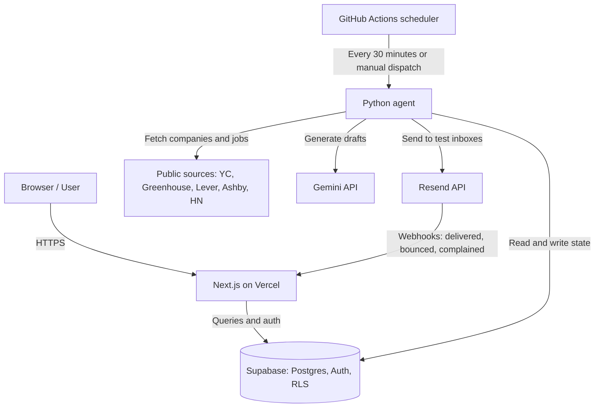

# Signal Desk

Signal Desk is a precision outbound platform that monitors public buying signals, scores prospect companies against an explainable ICP model, drafts grounded outreach with an LLM, and manages multi-step email sequences with deliverability guardrails. A human reviews and approves every first outreach message.

## What it is

Signal Desk automates outbound lead generation for B2B software companies targeting early-stage startups (Seed to Series A, roughly 5 to 60 employees).

- **Signal discovery**: Every 30 minutes, checks public sources for hiring announcements across Greenhouse, Lever, and Ashby, product launches on Hacker News, and recent YC funding batches.
- **Explainable scoring**: Evaluates companies against an Ideal Customer Profile (ICP) using an additive points formula. Every score shows its exact breakdown across ICP fit, signal type, freshness, and multi-signal stacking.
- **Grounded AI drafting**: Uses Gemini to generate three outreach angles (`signal`, `peer`, `short`) per qualified lead. Locked guardrails enforce that every specific claim links directly to a verifiable phrase in the underlying signal.
- **Sequence engine**: Executes multi-step email sequences with branch evaluation, mailbox rotation, deliverability monitoring, and human review before enrollment.

## System architecture



- **Next.js (App Router) on Vercel**: Web application providing the Queue, Leads table, Sequences timeline, Ops telemetry dashboard, and configurable Agent settings.
- **Supabase (Postgres, Auth, RLS)**: Relational database with Row Level Security enforcing organization isolation and role boundaries between admins and sales reps.
- **Python background agent**: Scheduled worker run via GitHub Actions (`7,37 * * * *`) that discovers companies, collects signals, computes scores, drafts outreach, and advances sequences.
- **Public data sources**: YC company directory, public ATS job boards (Greenhouse, Lever, Ashby), and Hacker News Algolia search API.
- **Gemini API**: Generates grounded email copy adhering to strict guardrail schemas.
- **Resend API and webhooks**: Dispatches outbound sequence emails and ingests webhook events with cryptographic signature verification.

## How the background agent works

The background agent runs as an idempotent tick (`agent/main.py`). Running a tick multiple times produces no duplicate rows or duplicate sends:

1. **Start run**: Writes an entry to `agent_runs` with the trigger source and start timestamp.
2. **Discover companies**: Loads the YC startup directory (cached for 24 hours) and checks basic ICP criteria (team size 5 to 60, active status, B2B, batch age). Probes public ATS endpoints on Greenhouse, Lever, and Ashby to discover career boards. Note: Ashby returns 403 to GitHub Actions runner IP addresses, so Ashby boards are checked during local agent runs.
3. **Fetch signals**:
   - **Hiring signals**: Fetches open jobs from discovered ATS boards. Classifies roles using keyword definitions, awards bonuses for founding sales roles, and extracts concise description excerpts.
   - **Launch signals**: Searches the Hacker News Algolia API for recent "Show HN" and "Launch HN" posts that strictly match the company domain or verified YC batch.
   - **Funding signals**: Converts recent YC batch participation into a low-weight funding signal.
   - **Fingerprinting**: Gives each signal a readable fingerprint (signal type, company and source id, for example `funding:<company>:yc:w24`) with a unique constraint, so a signal is never stored twice.
4. **Score leads**: Computes score parts based on ICP criteria, signal weights, signal freshness, and multi-signal stacking. Leads meeting the threshold (default 50 points) with at least one non-weak signal enter `ready` status. Unqualified leads are marked `filtered` with plain-text reasons.
5. **Contacts and buyer check**: Identifies founder or sales leadership contacts and flags non-buyer titles. Routes outbound email addresses to safe Resend test destinations (`delivered+{lead_id}@resend.dev`), assigning fixed shares to bounce and complaint test inboxes to exercise deliverability paths.
6. **Draft outreach**: For top qualified leads, requests three email angles (`signal`, `peer`, `short`) from Gemini. Verifies all drafts against locked guardrails (phrase grounding, word counts, banned marketing buzzwords, and dash bans). Tracks token counts against the daily budget (`LLM_DAILY_BUDGET`), reserving 20% of quota for on-demand web user regeneration.
7. **Advance sequences**: Evaluates active enrolled sequences for due steps and branching rules. Selects healthy mailboxes by rotation and sends messages via Resend using unique idempotency keys.
8. **Enforce deliverability**: Calculates bounce and complaint percentages from incoming events. Auto-pauses mailboxes that exceed safety limits (4% bounce rate or 0.3% complaint rate, once a mailbox has at least 20 sends). A paused mailbox stays paused until an admin resumes it from Ops.
9. **Finish run**: Records completed step durations, counts, error logs, and audit log entries.

## Real versus simulated data

Signal Desk operates with real live data across its ingestion, scoring, AI drafting, and sending pipelines, while clearly isolating simulation where sandbox services have natural limitations:

- **What is real**:
  - Real company records from the YC directory.
  - Real job board hiring signals scraped politely from Greenhouse, Lever, and Ashby.
  - Real product launch signals from Hacker News.
  - Real explainable scoring calculations and qualification rules.
  - Real LLM drafts generated by Gemini with live grounding verification.
  - Real email deliveries sent via Resend to `resend.dev` test inboxes.
  - Real bounce and complaint webhooks received from Resend and verified with Svix cryptographic signatures.
  - Real DNS TXT lookups checking SPF and DMARC configuration on the sending domain.
- **What is simulated**:
  - Prospect replies and email opens, triggered via explicit admin controls and prominently labeled "Simulated" across the interface.
- **Why simulated**:
  - Resend test inboxes cannot send email replies back to the sender.
  - Resend's free sandbox sender does not offer open tracking (open tracking requires a verified custom domain).
  - Admin simulation allows demonstrating branch evaluation, reply handling, and sequence cancellation without requiring external participant action.

## Running locally

### Prerequisites

- Node.js 20 or newer
- Python 3.12
- Git
- Supabase CLI

### Web setup

```bash
# Clone the repository
git clone https://github.com/ayocodes/signal-desk.git
cd signal-desk

# Install web dependencies
npm install

# Configure environment variables
cp .env.example .env.local
# Edit .env.local with your Supabase, Gemini, and Resend credentials

# Push migrations and seed data
supabase db push
npm run seed

# Start the Next.js development server
npm run dev
```

The web application will be accessible at `http://localhost:3000`.

### Background agent setup

```bash
# Set up Python virtual environment
python3 -m venv .venv
source .venv/bin/activate
pip install -r agent/requirements-dev.txt

# Run one agent tick locally
npm run agent:local

# Or run a dry-run tick without database writes
npm run agent:local:dry
```

### Running checks and tests

```bash
# Run web linter, typecheck, tests, and production build
npm run check

# Run Python agent tests
.venv/bin/python -m pytest agent/tests
```

## Resetting demo data

To reset the demo workspace back to a clean state for a presentation or walkthrough:

```bash
npm run seed:reset
```

To skip the interactive confirmation prompt:

```bash
npm run seed:reset -- --yes
```

This command deletes all sequences, scheduled steps, recovery proposals, and email events for the demo organization, returning those leads to "ready" status in the Queue. It resets mailbox counters, bounce rates, complaint rates, and pause statuses back to healthy. Companies, detected signals, lead scores, drafts, agent runs, agent rules, and the audit log remain intact.

## Demo accounts

Use the "Use demo admin" and "Use demo rep" buttons on the login page (`/login`) to sign in instantly without typing credentials:

- **Admin**: Full access across the organization, including the Queue, Leads table, Sequences, Ops page (telemetry, mailbox controls, engine stats, and audit logs), and editable Agent rules.
- **Rep**: Role-restricted view showing only leads assigned to that specific sales rep. Access to Ops and Agent rules editing is blocked by middleware (403 response) and denied at the database layer by Row Level Security.

## Design decisions

- **No LinkedIn**: No LinkedIn data, APIs, scraping, or messaging. Sequences are strictly email-based. Scraping LinkedIn violates platform terms of service, leads to account bans, and introduces fragile data pipelines.
- **Test inboxes**: All outbound emails are addressed strictly to Resend test inboxes (`delivered@resend.dev`, `bounced@resend.dev`, `complained@resend.dev` with `+label` suffixes). Real prospect names and company data are researched, but real people are never emailed during development or demonstration.
- **The grounding check**: Before an LLM draft can be approved, code verifies that phrases cited by the model appear verbatim in the source signal excerpt or title. This prevents hallucinations where an LLM invents fake company milestones or fabricated hiring needs.
- **GitHub Actions scheduling**: The background agent runs on a scheduled workflow (`7,37 * * * *`) every 30 minutes. This avoids Vercel Hobby's once-per-day cron restriction, runs within free tier limits on public repositories, and keeps the Supabase project active without requiring dedicated server infrastructure.
- **Row Level Security (RLS) multi-tenancy**: Every business table includes an `org_id` foreign key. Supabase RLS policies enforce tenant isolation and role restrictions directly in Postgres. Even if an API route omits a filter, unauthorized users and sales reps cannot access other workspaces, view leads assigned to someone else, or read mailboxes, agent runs and the audit log.

## Sales glossary

- **Lead**: A person or company that matches your target criteria and might buy your product.
- **ICP (Ideal Customer Profile)**: The description of company attributes (such as size, industry, and stage) that make a business a great fit for your product.
- **Buying signal**: A public event indicating a company has a new business need or budget, such as hiring for specific roles or launching a product.
- **Sequence**: A scheduled series of automated outreach emails sent across multiple days based on how the recipient interacts.
- **Enrolled**: A lead whose outreach sequence has been approved by a human and is actively receiving scheduled emails.
- **Open**: An event recorded when a recipient views an outreach email.
- **Reply**: A message sent back by a recipient, which immediately stops further automated sequence emails.
- **Bounce**: An email that could not be delivered because the address does not exist or the receiving mail server rejected it.
- **Complaint**: An event where a recipient marks an email as spam, which negatively impacts the sender's reputation.
- **Mailbox cap**: The maximum number of emails a mailbox may send in a single day to protect sender reputation.
- **Deliverability**: The likelihood that your emails reach the primary inbox rather than being rejected or routed to spam folders.
- **SPF (Sender Policy Framework)**: A DNS record specifying which email servers are authorized to send messages on behalf of your domain.
- **DMARC (Domain-based Message Authentication, Reporting, and Conformance)**: A DNS policy telling receiving servers how to handle emails that fail SPF or DKIM validation.
- **DKIM (DomainKeys Identified Mail)**: A cryptographic signature added to email headers that confirms the message was sent by the domain owner and not altered in transit.
